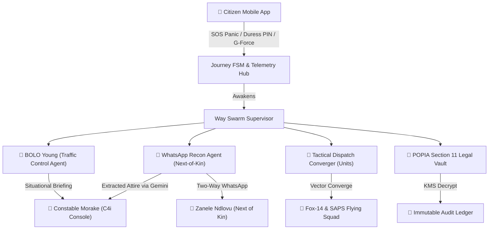

# WAYPOINT SECURE
## Autonomous Multi-Agent AI Tactical Defense & Transit Shield
### *Turning Reactive Panic into Anticipatory Rescue for South Africa*

---

## Slide 1: The Problem — The South African Transit Crisis
> *"In a crisis, a silent victim cannot type. A frightened victim cannot answer a phone call."*

* **The Reality in Gauteng**:
  * South Africa faces severe transit risks: roadside hijacking, kidnapping-for-ransom, express abductions, and GBV on arterial corridors (N12, M1, R21).
* **The 15-Minute Information Blackhole**:
  * When a distress signal is triggered, control rooms receive only a raw GPS coordinate.
  * Responders don't know: *What was the victim wearing today? Are they stationary? Who is their family? Has a struggle occurred?*
* **The Fatal Flaw of Legacy Panic Buttons**:
  * Legacy panic buttons are **passive** and **isolated**.
  * If a citizen is coerced or held at gunpoint, forcing them to cancel the alarm shuts down response teams entirely.

---

## Slide 2: The Solution — Waypoint Secure
### *Anticipatory Protection Powered by Multi-Agent AI*

* **Two-Tap Seamless Journey**:
  * **Tap 1**: Citizen sets destination with an active Dead-Man's Switch countdown and optional pre-departure photo.
  * **Tap 2**: Single-press Emergency SOS if threatened, or automatic trigger via G-force struggle impact (>3.0G) or 2G SMS GSM-7 failover.
* **Dual-PIN Anti-Coercion Security**:
  * **Standard PIN (`1234`)**: Disarms journey upon safe arrival.
  * **Duress PIN (`9999`)**: Shows a completely peaceful "Journey Completed" screen to the perpetrator, while secretly broadcasting Code Red distress and waking the AI Swarm.
* **The Way Swarm Engine**:
  * 4 specialized, autonomous Gemini-powered AI agents coordinate real-time rescue without human delay.

---

## Slide 3: Meet BOLO Young — AI Tactical Co-Pilot
> *"Inspired by martial legend Bolo Yeung — the hyper-vigilant sector guardian who never blinks."*

* **Autonomous Telemetry Watchdog**:
  * BOLO Young monitors corridor beacons at 1Hz, evaluating dead-man switch countdowns and geofence integrity.
* **Two-Stage Tactical Awareness**:
  1. **Stage 1 (Anticipation)**: The moment a citizen departs, BOLO alerts Constable Morake with destination and corridor telemetry:
     > *"Constable Morake, Thandiwe Ndlovu has activated a journey to Sandton. Status is safe. Monitoring corridor telemetry."*
  2. **Stage 2 (Emergency Briefing)**: Upon distress, BOLO provides instant contextual synthesis:
     > *"🚨 RED ALERT: Distress signal confirmed near N12 off-ramp. Stagnation threshold breached (>90s). Immediate intervention required."*
* **Contextual Decision Chips**:
  * Directly serves Constable Morake with 1-click tactical actions:
    * `[🚀 Deploy WhatsApp Recon Agent]`
    * `[🚓 Converge Tactical Reaction Units]`
    * `[📡 Broadcast Statutory BOLO to SAPS 10111 CAD]`

---

## Slide 4: The Way Swarm — Multi-Agent Architecture

---

## Slide 5: WhatsApp Recon Agent — Solving The Attire Deficit
### *Autonomous Conversational Intel Extraction via Gemini 2.5 Flash*

* **The Challenge**:
  * Responders cannot spot a victim in a crowded intersection without knowing today's clothing.
* **The Autonomous Recon Protocol**:
  * When Code Red triggers, the WhatsApp Recon Agent immediately engages the victim's emergency contact (Sister Zanele Ndlovu) via an encrypted WhatsApp bridge.
  * Operates with South African law enforcement empathy:
    > *"Zanele, this is Waypoint AI Tactical Recon liasing with SAPS Sector 2. Thandiwe has triggered an emergency alert. What is she wearing today?"*
* **Gemini Entity Extraction**:
  * Sister responds: *"She was wearing a yellow oversized hoodie, black Puma leggings, and white sneakers."*
  * Gemini extracts `{"upper": "yellow oversized hoodie", "lower": "black leggings", "footwear": "white sneakers"}` in under **400ms**.
  * Instantly beams the visual description onto Constable Morake's HUD and patrol vehicle screens.

---

## Slide 6: POPIA Section 11 Cryptographic Vault
### *Privacy by Design with Lawful Emergency Escalation*

* **Peace-Time State (Zero-Knowledge Privacy)**:
  * While journeys are GREEN, citizen biometric profiles (face scans, height, personal details) are locked under **AES-256-GCM** encryption using AWS KMS / Argon2id.
  * Operators only see anonymous telemetry vectors (`BEACON #d08139c7`).
* **Distress-Time State (Section 11 Exemption)**:
  * Under South African POPIA Section 11 (threat to life/bodily integrity), the vault decrypts biometric photos only when Code Red is declared.
* **Immutable Audit Trail**:
  * Every decryption event logs officer badge number, IP address, exact UTC timestamp, and statutory justification.

---

## Slide 7: Tactical C4i Command Center
### *Built for High-Stakes Operations Rooms*

* **Multi-Tenant Federation**:
  * Designed for SAPS (South African Police Service), Fox Tactical, Community Policing Forums (CPF), and Metro Police.
* **Persistent Awareness Everywhere**:
  * Global notification tray and floating tactical toast alerts ensure an officer working in any tab (Station Overview, Vault, B2B Fleet) never misses an active journey or distress signal.
  * Dual-Monitor / Popout window support for BOLO Young AI co-pilot.
* **High-Frequency GIS Radar**:
  * CartoDB Dark Matter tactical map rendering real-time responder vehicle convergence and victim telemetry vectors.

---

## Slide 8: Technical Architecture & Performance
* **Backend**:
  * FastAPI (Python 3.11) asynchronous core running on port 8000.
  * Dual WebSocket hubs: 100Hz client telemetry ingest & multi-tenant command broadcast.
  * Embedded SQLite + aiosqlite self-seeding spatial engine.
* **Frontend**:
  * Next.js 15 (React 19, TypeScript) with Tailwind CSS glassmorphic aesthetic.
  * Mobile-responsive citizen PWA + multi-pane command workstation.
* **AI Intelligence**:
  * Google Gemini 2.5 Flash & Flash Lite multi-model rotation for ultra-low latency (<500ms) conversational synthesis.
* **Resilience**:
  * 2G SMS GSM-7 fallback parser for load-shedding network collapse scenarios.

---

## Slide 9: Commercialization & B2B SaaS Model
### *Unlocking Enterprise Value in South Africa's R45B Security Sector*

| Tier | Target Market | Monthly Fee | Features |
| :--- | :--- | :--- | :--- |
| **Tier 1: Community Guardian** | CPF & Neighborhood Watches | Free / Subsidized | 2-Tap SOS, Basic SMS alerting, Volunteer Dispatch |
| **Tier 2: Tactical Armed Reaction** | Private Security (Fidelity, ADT, Fox) | **R499 / patrol vehicle** | Full Way Swarm, WhatsApp Recon, Stagnation Audits |
| **Tier 3: Provincial Command Mesh** | SAPS & Provincial C4i | Enterprise License | Inter-agency CAD broadcast, POPIA Section 11 Vault |

---

## Slide 10: Summary & The Way Forward
* **Live Production Deployments (Accessible 24/7)**:
  * 🖥️ **C4i Command Dashboard**: [https://command-dashboard-phi.vercel.app](https://command-dashboard-phi.vercel.app)
  * 📱 **Citizen Mobile App**: [https://waypoint-citizen-mobile.vercel.app](https://waypoint-citizen-mobile.vercel.app)
  * ⚙️ **Core Backend API (Render)**: [https://waypoint-scr.onrender.com](https://waypoint-scr.onrender.com)
* **Why Waypoint Secure Wins**:
  1. **Not a Prototype**: Production-grade architecture with real Gemini LLM integration, WebSockets, and cryptographic safeguards.
  2. **True Anti-Coercion**: Dual-PIN protocol eliminates hostage compliance dilemmas.
  3. **Zero Information Gaps**: Autonomous WhatsApp recon bridges the gap between raw GPS and tactical visual identification.
  4. **Localized for South Africa**: Built specifically for Gauteng transit corridors, CPF collaboration, and load-shedding resilience.

> **"Waypoint Secure turns every road into a guarded corridor, ensuring no South African ever travels alone."**
